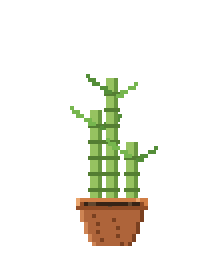
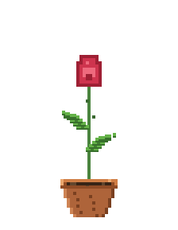
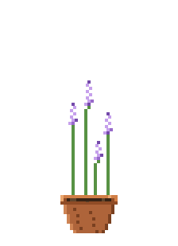
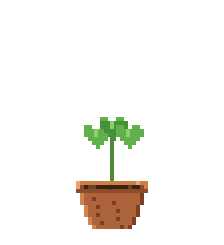
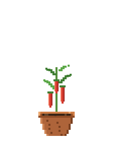

# TaskbarPlant 桌面电子盆栽（记得看看最后！）


Windows 桌面上的一盆「电子盆栽」：单个 C++ 文件、无第三方依赖，编译出来就是一个 exe。
透明的悬浮层铺在任务栏以上的整个工作区，花盆会从桌面或窗口标题栏上掉下来，可以拖动、抛出、浇水、养多盆。

> 直接下载：[Releases](https://github.com/Ziyi-Zhao-star/TaskbarPlant/releases) → `TaskbarPlant.exe`，双击即用，无需安装。

## 植物图鉴

|  |  |  |  |
|:--:|:--:|:--:|:--:|
| 仙人掌 | 向日葵 | 食人花 | 郁金香 |
|  |  |  |  |
| 蘑菇 | 小松树 | 多肉 | 竹子 |
|  |  |  |  |
| 玫瑰 | 薰衣草 | 三叶草 | 辣椒 |
|  |  |  |  |
| 蒲公英 |  |  |  |

> 上表图片由程序的「导出植物图片」功能生成（`Plants\` 文件夹），与游戏内实际像素完全一致。

## 功能

- **自由摆放**：花盆有重力、弹跳、旋转，可以停在桌面或任意窗口标题栏上；拖拽甩出、落地扬尘
- **13 种植物**：仙人掌 / 向日葵 / 食人花 / 郁金香 / 蘑菇 / 小松树 / 多肉 / 竹子 / 玫瑰 / 薰衣草 / 三叶草 / 辣椒 / 蒲公英
- **会渴的植物**：水分随时间蒸发，缺水后不断掉落枯叶碎片（带物理，会落到地面），浇水后恢复
- **浇水动画**：水滴落下 + 植物被浇得晃动，水分快速回填
- **编辑模式**：像摆家具一样调花盆的数量、位置、大小，并可修改干枯时间；**点「保存」才写入配置**
- **逐像素透明**：只有花盆和植物的像素可点，透明区域鼠标直接穿透到下层窗口
- **不抢任务栏**：窗口只铺任务栏以上的工作区，永远不会盖住任务栏
- **不抢焦点**：全屏视频 / 游戏时自动隐藏，结束后悄悄回来

## 使用说明

1. 双击 `TaskbarPlant.exe` 启动，桌面上会出现一盆向日葵。
2. **左键按住花盆**可以拖动、甩出；**按住植物**可以把它拉弯，松手回弹。
3. **右键**任意位置弹出像素风菜单：
   - 上半部分是 13 种植物（双栏排列），点哪个就换哪个
   - `浇水`：给当前花盆浇水
   - `编辑模式`：进入 / 退出编辑模式
   - `花盆调大` / `花盆调小`：调整当前花盆大小（0.65x ~ 1.45x）
   - `放置新花盆` / `移除这个花盆`
   - `导出植物图片`：把 13 种植物重新导出到 `Plants\`
   - `退出程序`

### 编辑模式

进入编辑模式后，屏幕顶部出现一条工具条：

| 按钮 | 作用 |
|:--|:--|
| `+ 新花盆` | 在场景中随机放一盆新植物 |
| `干枯 N 秒` | 点击在 30 / 60 / 120 / 180 / 300 秒之间循环，决定「满水 → 干透」的时长 |
| `保存` | 把当前花盆数量、位置、大小、水分、干枯时间写入 `TaskbarPlant.ini` |
| `完成` | 退出编辑模式 |

编辑模式下：水分停止蒸发、枯叶停止掉落，所有改动只存在于内存中，**不点「保存」就不会写盘**；退出程序时如果仍在编辑模式，也不会保存。

### 配置文件

保存在 exe 同目录的 `TaskbarPlant.ini`：

```ini
# TaskbarPlant: plant x y scale moisture
dry 180
1 1280.0 1368.0 1.000 0.917
8 960.0 1368.0 1.300 0.640
```

- 每行一盆：`植物编号 x y 缩放 水分`（植物编号对应菜单顺序，从 0 开始）
- `dry <秒>`：满水到干透的时间
- 除点「保存」外，非编辑模式下每 5 秒自动保存一次，退出时也会保存

## 技术实现

整个项目是**单文件 Win32 + GDI+**，没有任何第三方库 / Electron / 前端框架，静态链接后 exe 约 360 KB。

**1. 逐像素透明 + 点击穿透**
主窗口使用 `WS_EX_LAYERED | WS_EX_TOOLWINDOW | WS_EX_TOPMOST | WS_EX_NOACTIVATE`，
后台维护一个 32bpp 预乘 alpha 的 DIB，通过 `UpdateLayeredWindow(..., ULW_ALPHA)` 整块提交。
ULW 的分层窗口按 alpha 做命中测试，alpha=0 的像素点击直接穿透到下面的窗口。

**2. 不遮任务栏**
窗口矩形只铺 `SPI_GETWORKAREA` 得到的工作区（任务栏以上）。只要窗口矩形盖住整块显示器，
Explorer 会把任务栏的 `WS_EX_TOPMOST` 去掉，之后任何活动窗口都会压到任务栏上——这是最初版本踩过的坑。

**3. 脏矩形增量重绘**
全屏 2560×1440 每帧整块提交太贵，所以每帧只处理变化区域：
`SpriteBounds()` 计算这一帧所有精灵的 AABB（花盆旋转后的四角、投影、枯叶粒子）→ 与上一帧脏区合并 →
`ClearRect` → GDI+ 绘制 → `PremultiplyRect`（预乘 alpha）→ `UpdateLayeredWindowIndirect(prcDirty)` 只提交这块。

**4. 像素画渲染**
所有绘制吸附到 4px 网格（`SnapPx`），并关闭抗锯齿：
`SmoothingModeNone` + `CompositingModeSourceCopy` + `PixelOffsetModeHalf`。
像素椭圆按 4px 行逐行栅格化（边缘自然是阶梯），植物叶片是逐格收窄的阶梯矩形，
花盆是 9 行像素块拼出的收腰轮廓。

**5. 物理**
自写 2D 刚体：重力 2400 px/s²、地面 / 窗口标题栏承托、弹跳系数、角速度与自动回正、
植物摆动用阻尼弹簧（stiffness 110 / damping 6.5）、拖拽时用相邻两帧位移估算甩出速度。
花盆下方用 `EnumWindows` 按 z 序找到真正托住它的窗口，所以可以停在别的窗口标题栏上。

**6. 水分与枯叶**
水分 `moisture` 从 1 线性蒸发到 0；低于 0.4 后按节流间隔在植株上随机位置生成枯叶粒子，
粒子受重力 420 px/s² 下落、带横向飘动，落地后加速消失。浇水动画 2.2 秒，期间水分快速回填。

**7. 编辑模式 HUD**
工具条直接画在同一张 DIB 上，并并入脏矩形提交。
注意 GDI+ 在 HDC 上绘制文字会走 GDI 路径，写进 DIB 的 alpha 是 0，预乘后文字直接消失——
必须设置 `TextRenderingHintAntiAlias` 让 GDI+ 自己光栅化。

**8. 菜单 / 持久化**
右键菜单是自绘的 `WS_POPUP` 像素风窗口（21 项：13 种植物双栏 + 8 条命令单列，鼠标捕获实现「点外面关闭」）；
配置是纯文本 ini，启动时解析恢复，非编辑模式下每 5 秒 + 退出时写盘。

## 编译

需要 Windows 10/11 + C++17。两种方式任选：

**MinGW-w64（推荐，双击 `build.bat` 也可以）**

```bat
g++ -std=c++17 -O2 -municode -mwindows TaskbarPlant.cpp -o TaskbarPlant.exe ^
    -lgdiplus -lgdi32 -luser32 -ldwmapi -static -s
```

**MSVC（x64 Native Tools 命令行）**

```bat
cl /nologo /EHsc /O2 /DUNICODE /D_UNICODE TaskbarPlant.cpp ^
   /link gdiplus.lib user32.lib gdi32.lib dwmapi.lib /SUBSYSTEM:WINDOWS
```

只依赖系统自带的 GDI+（`gdiplus.lib`），无需安装任何运行时。

## 版本

当前版本：**v3.5.0**

- `v3.5.0`：添加 MIT 许可证；右键菜单重新排版（植物双栏 + 命令分组，高度从 730px 降到 478px）；取消启动时自动导出植物图片（改为菜单里手动导出）
- `v3.0.0`：修复导出的植物图片顶部被裁切、根部陷进盆身的问题（画布按植株实际高度计算）
- `v2.0.0`：编辑模式（花盆数量 / 位置 / 大小、可调干枯时间、点保存才写 ini）、枯叶掉落物理、移除水滴图标、13 种植物、水分与浇水动画、ini 持久化
- 更新日志与下载：[Releases](https://github.com/Ziyi-Zhao-star/TaskbarPlant/releases)

## 许可

本项目使用 [MIT License](LICENSE)，可自由使用、修改、商用和再分发，保留版权与许可声明即可。

## 你在找 Linux 版吗？

我的朋友已经移植好了：<https://github.com/Epiphany106-blip/taskbarplant-linux>
- 记得给他点个 star
